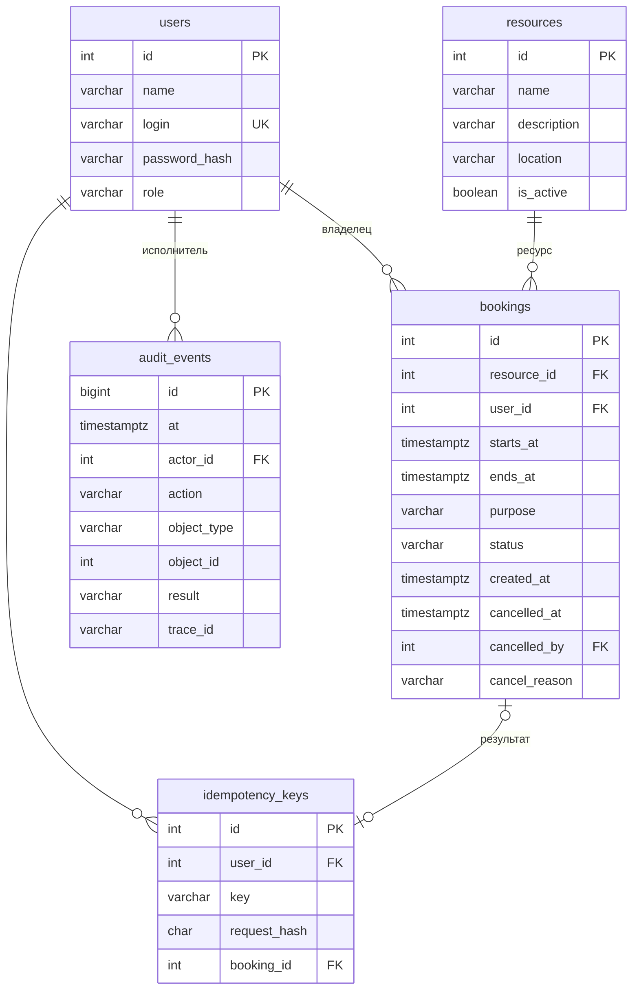

# Бронь без конфликтов

Веб-сервис бронирования **аудиторий колледжа**. Учебный проект, итоговая лабораторная работа по МДК.09.01.

Автор: Гуров Ярослав, группа К841.

Главное свойство сервиса: одну аудиторию нельзя забронировать на пересекающееся время. Правило соблюдается и при одновременных запросах, и при нескольких экземплярах сервера.

## Содержание

1. [Назначение и пользователи](#1-назначение-и-пользователи)
2. [Стек](#2-стек)
3. [Правила](#3-правила)
4. [Сценарии](#4-сценарии)
5. [Схема данных](#5-схема-данных)
6. [Защита от конфликтов и повторных запросов](#6-защита-от-конфликтов-и-повторных-запросов)
7. [Установка и запуск](#7-установка-и-запуск)
8. [CI/CD и публикация](#8-cicd-и-публикация)
9. [Документы](#9-документы)

## 1. Назначение и пользователи

- **Ресурсы:** аудитории, компьютерные классы и переговорные колледжа. Каждая аудитория бронируется целиком.
- **Пользователь:** смотрит каталог и занятое время, бронирует аудиторию для себя, смотрит и отменяет свои будущие записи.
- **Администратор:** может всё то же, что пользователь. Кроме того, видит все записи и их владельцев, отменяет чужие записи с причиной, создаёт, изменяет и отключает ресурсы, смотрит аудит.

## 2. Стек

| Часть | Технология |
|---|---|
| Сервер | Node.js 20+, Express 4 |
| БД | PostgreSQL 14+ (расширение `btree_gist`) |
| Аутентификация | bcryptjs (хеш пароля) + JSON Web Token (из прошлой работы «WebApi NodeJS, JWT») |
| Клиент | HTML, CSS, JavaScript без фреймворков (`public/`) |
| Проверка кода | ESLint |
| CI/CD | GitHub Actions → Render (Deploy Hook) |

## 3. Правила

### Время

- Аудитории доступны ежедневно с **08:00 до 22:00 по московскому времени**.
- Время выбирается с шагом **30 минут**. Продолжительность — от 30 минут до 4 часов.
- Бронирование целиком помещается в один день. Окончание позже начала.
- Начало не в прошлом и не дальше чем **через 30 суток**. Проверка идёт по серверному времени.
- API принимает дату со смещением часового пояса (`2026-10-25T10:00:00+03:00`). БД хранит момент в UTC (`timestamptz`). Интерфейс везде подписывает время как МСК.

### Пересечение

Интервал полуоткрытый: `[начало, окончание)`, поэтому момент окончания свободен. Конфликт возникает, если новое начало раньше существующего окончания **и** новое окончание позже существующего начала. Проверяются только **активные** записи **одного** ресурса. Отменённые записи время не занимают.

### Отмена

- Владелец отменяет свою запись до её начала.
- Администратор отменяет любую будущую запись. Для чужой записи причина обязательна.
- Начавшиеся и завершённые записи отменить нельзя (`409`).
- Повторная отмена ничего не меняет и не создаёт новых событий.
- Сохраняются исполнитель, время и причина отмены. Запись не удаляется.

### Доступ

- Владелец новой записи определяется **сервером по JWT**. `userId` и роль из тела запроса игнорируются. Роль при каждом запросе читается из БД.
- Чужая запись для обычного пользователя отвечает `404`: данные не раскрываются.
- Административные маршруты отвечают `403` обычному пользователю. Защита работает и при прямом запросе, даже если кнопки в интерфейсе нет.
- Отключённый ресурс недоступен для новых записей, существующие записи сохраняются.
- Физическое удаление ресурсов и записей не реализуется.

### Согласованные изменения

Изменений нет.

## 4. Сценарии

**Основной:** вход → каталог → аудитория → дата и занятые интервалы → форма (дата, начало, окончание, цель) → экран подтверждения → «Подтвердить» → сообщение с номером записи → запись видна в «Мои брони».

| Альтернатива | Поведение |
|---|---|
| Ресурс отключён | В карточке сообщение, формы нет. Запрос через API отвечает `409 RESOURCE_DISABLED` |
| Время занял другой пользователь | `409 BOOKING_CONFLICT` «Ресурс уже занят в выбранное время», список занятого времени обновляется |
| Неверные даты | `400 VALIDATION_ERROR`, ошибка показывается рядом с полем |
| Истёк JWT | `401 TOKEN_EXPIRED`, переход на вход с сообщением «Войдите снова» |
| Ответ потерян | Данные формы и ключ запроса сохраняются, кнопка «Повторить отправку» отправляет тот же ключ, дубликата нет |
| Кнопка нажата повторно | Кнопка блокируется на время отправки. Повтор с тем же ключом возвращает ту же запись |
| Доступ к чужой записи | `404`, данные не раскрываются и не меняются |

## 5. Схема данных

Миграция: [`migrations/001_init.sql`](migrations/001_init.sql).



**Ограничения:**

- внешние ключи;
- `NOT NULL`;
- длина цели от 5 до 300 символов;
- `ends_at > starts_at`;
- статусы только `active` и `cancelled`, сведения об отмене заполнены только у отменённых;
- `UNIQUE (user_id, key)` для ключей повтора;
- `EXCLUDE` против пересечений (см. раздел 6).

Состояния «идёт» и «завершена» не хранятся, а вычисляются по времени (`src/services/format.js`), поэтому фоновое обновление не нужно.

**Индексы:**

| Индекс | Для какого запроса |
|---|---|
| `bookings_user_idx (user_id, starts_at DESC)` | `GET /api/bookings/my`: записи пользователя, новые сверху |
| `bookings_resource_time_idx (resource_id, starts_at) WHERE status='active'` | `GET /api/resources/{id}/availability`: занятые интервалы ресурса за день, а также фильтр админа по ресурсу |
| GiST-индекс ограничения `bookings_no_overlap` | Поиск пересечения при каждой вставке брони |
| `idempotency_user_key_uniq (user_id, key)` | Поиск ключа повтора при `POST /api/bookings` |
| `audit_events_at_idx (at DESC)` | `GET /api/admin/audit`: последние события |
| `users.login UNIQUE` | Вход по логину |

**Учебные данные** (`npm run seed`, каждый запуск пересоздаёт данные):

- 6 ресурсов, один из них отключён;
- администратор `admin` и пользователи `ivanov`, `petrova`;
- будущие активные, отменённая и завершённые записи.

Пароли берутся из переменных `SEED_ADMIN_PASSWORD` и `SEED_USER_PASSWORD`, в репозиторий не попадают.

## 6. Защита от конфликтов и повторных запросов

### Почему «проверить, потом вставить» не работает

Два запроса одновременно выполняют `SELECT`, оба видят свободное время, и оба делают `INSERT`. Проверка в коде не видит ещё не сохранённую запись соседнего запроса.

### Выбранный механизм: ограничение PostgreSQL

Код: [`migrations/001_init.sql`](migrations/001_init.sql), ограничение `bookings_no_overlap`.

```sql
CONSTRAINT bookings_no_overlap EXCLUDE USING gist (
    resource_id WITH =,
    tstzrange(starts_at, ends_at, '[)') WITH &&
) WHERE (status = 'active')
```

Правило сформулировано так: не может быть двух строк, где ресурс равен (`=`), интервалы пересекаются (`&&`) и обе строки активны. Проверку выполняет сама БД при вставке.

- Если второй запрос пришёл одновременно, PostgreSQL ждёт завершения первой транзакции и после её `COMMIT` отклоняет вторую с ошибкой `23P01`.
- Сервер превращает эту ошибку в `409 BOOKING_CONFLICT` ([`src/routes/bookings.js`](src/routes/bookings.js), блок `catch` вокруг `INSERT INTO bookings`).
- Вся операция идёт в одной транзакции (`withTransaction`, [`src/db.js`](src/db.js)). При отказе выполняется `ROLLBACK`, частично сохранённых данных не остаётся.
- Правило хранится в БД, а не в памяти сервера, поэтому работает при **любом числе экземпляров** приложения.
- `'[)'` означает, что окончание не входит в интервал: соседние записи 10:00–11:00 и 11:00–12:00 разрешены.

### Отключение ресурса одновременно с бронированием

- При создании брони строка ресурса блокируется `SELECT … FOR SHARE`, и только после этого проверяется `is_active`.
- Отключение (`PATCH /api/admin/resources/{id}`, [`src/routes/admin.js`](src/routes/admin.js)) блокирует ту же строку `FOR UPDATE`.

Эти блокировки несовместимы: если отключение уже идёт, бронь ждёт и потом видит `is_active = false`; если идёт бронь, отключение ждёт её окончания. Порядок блокировок в обеих операциях одинаковый: сначала строка ресурса, поэтому взаимной блокировки нет.

### Повторные запросы: Idempotency-Key

Код: [`src/routes/bookings.js`](src/routes/bookings.js), таблица `idempotency_keys`.

1. Перед первой отправкой клиент создаёт случайный ключ (`crypto.randomUUID()`, [`public/app.js`](public/app.js)) и передаёт его в заголовке `Idempotency-Key`. При повторе тех же данных отправляется тот же ключ, при изменении данных — новый.
2. В начале транзакции сервер выполняет `INSERT INTO idempotency_keys … ON CONFLICT (user_id, key) DO NOTHING`.
3. Если ключа ещё нет, он сохраняется вместе с отпечатком данных (SHA-256 от ресурса, начала, окончания и цели). Бронь создаётся **в той же транзакции**, затем ключ получает ссылку на неё.
4. Если ключ уже есть, это повтор:
   - отпечаток совпадает — сервер возвращает исходную бронь (`200`, заголовок `Idempotent-Replayed: true`) без новой вставки;
   - отпечаток другой — `409 IDEMPOTENCY_KEY_REUSED`.
5. Одновременные повторы одного ключа: уникальный индекс заставляет второй `INSERT` ждать первую транзакцию. После её `COMMIT` второй запрос видит ключ и получает исходный результат. Если первая транзакция откатилась (например, из-за конфликта), ключ не сохранился, и повтор выполняется заново. Нарушение уникальности не превращается в `500`, потому что используется `ON CONFLICT DO NOTHING`.

Отключать кнопку на клиенте мало: запрос может повториться после сетевого сбоя, когда сервер уже сохранил запись, а ответ потерялся.

### Ключ повтора и проверка пересечения — разные задачи

- **Ключ** отвечает на вопрос «это та же самая попытка?» и защищает от дубликата **одной** операции.
- **Ограничение** отвечает на вопрос «не занято ли время?» и защищает от конфликта **разных** операций, в том числе от разных пользователей.

### Отмена

`SELECT … FOR UPDATE` по строке брони. Второй одновременный запрос ждёт первый, видит статус `cancelled` и возвращает запись без изменений и без второго события аудита. Обновление и аудит идут в одной транзакции.

## 7. Установка и запуск

### Требования

- Node.js 20 или новее (`node -v`), npm;
- PostgreSQL 14 или новее, клиентские утилиты `psql`, `pg_dump`, `pg_restore`;
- Git.

### Шаги

```bash
# 1. Зависимости
npm install

# 2. Настройки: скопировать пример и вписать свои значения
copy .env.example .env        # Windows (в Linux/macOS: cp .env.example .env)

# 3. База данных (пароль postgres — свой)
psql -U postgres -c "CREATE DATABASE bron"

# 4. Миграции и учебные данные
npm run migrate
npm run seed

# 5. Запуск
npm start
```

| Адрес | Что там |
|---|---|
| http://localhost:8080 | Интерфейс |
| http://localhost:8080/health/live | Процесс жив |
| http://localhost:8080/health/ready | Готов к работе, БД доступна (иначе `503`) |
| [`docs/API.md`](docs/API.md) | Описание API |

### Переменные окружения

Пример: [`.env.example`](.env.example).

| Переменная | Назначение |
|---|---|
| `PORT` | Порт веб-сервера (по умолчанию 8080) |
| `DATABASE_URL` | Строка подключения к PostgreSQL |
| `DATABASE_SSL` | `true` для облачной БД с SSL |
| `JWT_SECRET` | Секрет подписи JWT |
| `JWT_EXPIRES_IN` | Срок действия JWT (`1h`; для проверки истечения можно поставить `60s`) |
| `SEED_ADMIN_PASSWORD`, `SEED_USER_PASSWORD` | Пароли демонстрационных учётных записей |

### Демонстрационные учётные записи

Логины `admin`, `ivanov`, `petrova` создаются командой `npm run seed`. Пароли — те, что указаны в `.env`. Преподавателю они передаются лично, в репозитории их нет. Новый пользователь может зарегистрироваться на странице входа.

### Миграции

- `npm run migrate` применяет новые файлы из `migrations/` по порядку и запоминает их в таблице `schema_migrations`.
- Скрипт берёт `pg_advisory_lock`, поэтому два процесса миграции одновременно не выполнятся.
- В облаке миграции запускаются перед стартом сервера одной командой `npm run release`.

## 8. CI/CD и публикация

Файл конвейера: [`.github/workflows/ci-cd.yml`](.github/workflows/ci-cd.yml).

```
push → [Checkout] → [npm ci] → [ESLint] → [Build: node --check + dist/] → [artifact] → [Deploy hook] → [/health/ready]
```

- **CI** (`Lint & Build`) запускается на каждый push и Pull Request в `main`. Автотесты API не входят, по заданию.
- **Deploy** запускается только после успешного CI (`needs: ci`) и только для push в `main`.
- Публикация: GitHub Actions вызывает Deploy Hook сервиса на Render (описание среды в [`render.yaml`](render.yaml), `autoDeploy: false`). Сервер выполняет `npm run release`: сначала миграции, потом старт.
- Затем конвейер ждёт, пока `/health/ready` ответит `200`.
- **Секреты:**
  - `DEPLOY_HOOK_URL` хранится в GitHub → Settings → Secrets and variables → Actions → Secrets;
  - адрес приложения `APP_URL` хранится в Variables;
  - `JWT_SECRET` и `DATABASE_URL` хранятся в настройках Render.
  
  В журналах конвейера секреты не выводятся.
- Если `DEPLOY_HOOK_URL` не задан, шаг публикации пропускается с предупреждением.

**Блокировка публикации при ошибке.** Синтаксическая ошибка в любом `.js` останавливает задачу `Lint & Build`, и задача `Deploy` не запускается (статус «skipped»).

### Первая публикация на Render

1. На render.com: New → Blueprint → выбрать репозиторий. Render создаст веб-сервис и БД по `render.yaml`.
2. В настройках сервиса: Settings → Deploy Hook → скопировать адрес.
3. В GitHub добавить секрет `DEPLOY_HOOK_URL` и переменную `APP_URL` (например, `https://bron-bez-konfliktov.onrender.com`).
4. Учебные данные — один раз с локального компьютера, используя External Database URL из Render:
   ```bash
   set DATABASE_URL=<External Database URL>
   set DATABASE_SSL=true
   npm run seed
   ```

## 9. Документы

| Документ | Содержание |
|---|---|
| [docs/API.md](docs/API.md) | Маршруты, параметры, права, ответы и ошибки |
| [docs/PROTOCOL.md](docs/PROTOCOL.md) | Протокол ручной проверки |
| [docs/BACKUP.md](docs/BACKUP.md) | Резервное копирование и восстановление |
| [docs/DIAGNOSTICS.md](docs/DIAGNOSTICS.md) | Журналы, traceId, проверка готовности |
